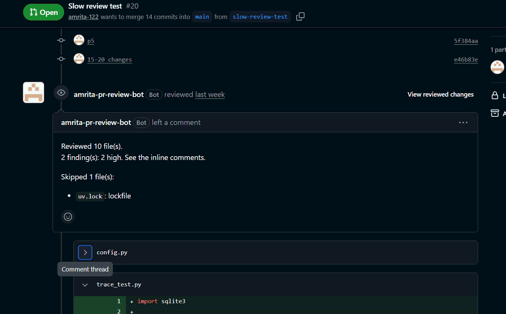
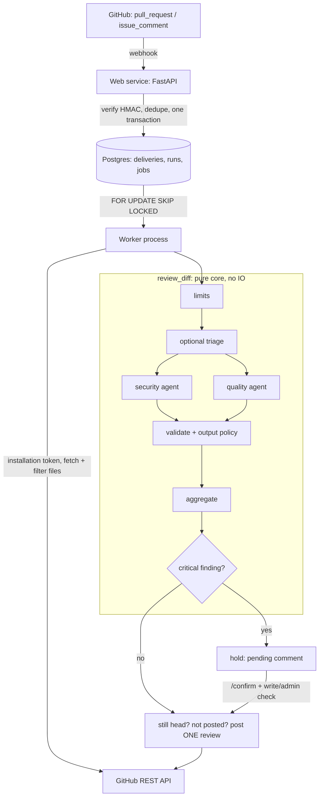

# PR Review Agent

A GitHub App that reviews pull requests with LLM agents. When a PR is opened or updated, it fetches the
diff, runs a security agent and a code-quality agent (LangGraph), validates every finding, and posts
**one** review with inline comments on the right lines.

It is built around two questions most demo "AI reviewers" skip: *how good is it, in numbers?* and
*what can an attacker do through a PR?*



## What it does

- Reviews each changed file with a **security** agent and a **quality** agent in parallel, merges
  overlapping findings, sorts by severity and caps the review at 25 inline comments.
- Every finding is **validated** before posting: the file was reviewed, the line is commentable, and the
  text passes an output policy (no links, @mentions or dangerous HTML).
- Treats all PR content as **untrusted**. The bot only ever posts `event=COMMENT`: it never approves,
  requests changes, merges or writes to the repository.
- Survives restarts: a Postgres job queue and a separate worker mean no lost reviews, no duplicate
  reviews, and no review of a commit that is no longer the PR's head.
- Optional human gate: a critical finding is held until a maintainer replies `/confirm`.

## Results

All numbers come from this repo's own eval sets and are reproducible with `uv run python -m evals.run`.
Reviewer model `claude-sonnet-5-5`; each figure is a mean of 3 runs unless stated.

| What | Result | Measured on |
|---|---|---|
| Security agent, final prompt (`security_v5`) | precision **93.6%**, recall **96.7%** | golden set, 20 planted bugs |
| Eval gate (CI, on PRs touching `app/review/**` or `evals/**`) | fails under 85% precision or recall | blocked a deliberately noisy prompt (62.5% precision) |
| Prompt injection, output hijack | **10.3% -> 0%** (0 of 13 with a canary) | 16 red-team cases, baseline vs final |
| Prompt injection, suppression of a real bug | **0 of 16**, before and after | same set (no headroom: see limitations) |
| Cost | about **$0.007 per file** (security agent) | golden set, list prices |
| Latency | p50 about 2 s, p95 about 3 s per file | golden set |
| Quality agent | recall 87.5%, **precision 35%** | 43-case golden set; no CI gate yet |
| Triage (cheap model for low-risk files) | **no saving** on small files, so off by default | 5 multi-file PRs, 16 files |

Why these are not bigger or rounder: the golden set is small (one missed bug is about 5 points of recall),
and `security_v2` hit 100% only because it was written after reading v1's failures on the same set, so that
figure is not claimed. Per-run counts, caveats and the table of every defence step are in
[docs/SECURITY.md](docs/SECURITY.md) and [docs/BUILD-LOG.md](docs/BUILD-LOG.md).

The prompt-injection finding worth reading: the ~10% "hijack" at baseline was mostly the model **quoting**
the attack, not obeying it, because the prompt told it to report injection attempts. Removing that
instruction (prompt v4) and adding an output policy (links cannot be prevented by a prompt) brought it to 0.

## Architecture



More detail, the data model and trust boundaries: [docs/ARCHITECTURE.md](docs/ARCHITECTURE.md).

## Design decisions

| Decision | Why | Record |
|---|---|---|
| Scope and stack (Python, FastAPI, LangGraph, httpx, no GitHub SDK) | small, inspectable surface | [ADR 0001](docs/decisions/0001-v1-scope-and-stack.md) |
| Build order: skeleton, posting pipeline, then the LLM | prove delivery and line mapping before adding AI | [ADR 0002](docs/decisions/0002-phase-order.md) |
| Eval methodology: labels written before running the model, line-range matching | avoid grading the model on its own answers | [ADR 0003](docs/decisions/0003-eval-methodology.md) |
| Injection defences, each re-measured on its own | know which layer does what | [ADR 0004](docs/decisions/0004-injection-defences.md) |
| Job queue in Postgres, not Redis/Celery | no new infrastructure; transactional with the webhook | [ADR 0005](docs/decisions/0005-postgres-job-queue.md) |
| Second agent and triage, triage off by default | measured: no saving at this file size | [ADR 0006](docs/decisions/0006-second-agent-and-triage.md) |
| Human `/confirm` gate that fails closed after 72 h | a maintainer, not the model, releases critical findings | [ADR 0007](docs/decisions/0007-human-confirmation.md) |

## Limitations

- **Small eval sets.** 20 planted bugs and 16 red-team cases: read counts, not just percentages. The
  golden set can no longer show further improvement for the security prompt.
- **Suppression is unproven.** The model resisted every direct suppression attempt even at baseline, so the
  red-team set only guards against regressions. Subtler, in-voice justifications still need to be added.
- **Quality agent precision is 35%.** It finds bugs but also flags real-looking issues in clean code, so
  there is no quality threshold in the CI gate.
- **Oversize files are skipped, not reviewed** (over 20k characters); the summary lists them.
- **Injection attempts are ignored silently** since prompt v4. Model-level injection is never zero; the
  layers only bound the damage to a vetted comment.
- **No per-author rate limit.** A push storm is bounded by superseding older runs, not by a quota.
- **`/confirm` from a non-maintainer** was verified by unit tests only, not with a real second account.
- **Triage savings** are unmeasured for PRs with many large docs or test files.
- **Findings are public on public repos** (even after `/confirm`). Do not install the App on public repos with real
  code until Phase 10 branch 3 (private delivery, [ADR 0008](docs/decisions/0008-private-delivery-for-public-repos.md)).
- **Known bugs, fixed in Phase 10** (see TASKS.md): a late webhook can lose the newest review; a review can say
  "No findings." when files failed; closed PRs and drafts are not handled; old comments are never corrected.

Full list: [docs/SECURITY.md](docs/SECURITY.md#residual-risks).

## Install

Requires Python 3.12, [uv](https://docs.astral.sh/uv/), Docker (for local Postgres), and an Anthropic API key.

1. **Create a GitHub App** (Settings > Developer settings > GitHub Apps > New). Permissions: Pull requests
   *Read & write*, Contents *Read-only*, Metadata *Read-only* (GitHub shows any extra one the "Issue comment"
   event needs). Subscribe to **Pull request** (and **Issue comment** if you enable `/confirm`). Set a random
   webhook secret (`python -c "import secrets; print(secrets.token_hex(32))"`). Generate a private key and
   base64-encode it. Install the App on a test repo only.
2. **Configure**: `cp .env.example .env` and fill it in (App ID, webhook secret, base64 private key,
   `DATABASE_URL`, `MODEL_REVIEW`, your Anthropic key). Never commit `.env` or `*.pem`.
3. **Database**:
   ```bash
   docker run -d --name pr-review-db -e POSTGRES_PASSWORD=postgres -e POSTGRES_DB=pr_review -p 5432:5432 postgres:16
   uv sync
   uv run alembic upgrade head
   ```
4. **Run the web service and the worker** (two processes):
   ```bash
   uv run fastapi dev app/main.py
   uv run python -m app.jobs.worker
   ```
5. **Receive webhooks locally**: create a channel at smee.io, use it as the App's webhook URL, then
   `npx smee-client --url $SMEE_URL --target http://localhost:8000/webhooks/github`.
6. **Open a PR** on the test repo. For production, the repo ships a `Dockerfile`, `railway.json` (web) and
   `railway.worker.json` (worker); run `alembic upgrade head` as the pre-deploy command and set the same env vars.

Optional switches (all off or defaulted in `.env.example`): `TRIAGE_ENABLED`, `CONFIRMATION_ENABLED`,
`CONFIRM_TTL_HOURS`, `CONFIRM_SEVERITIES`.

### Develop

```bash
uv run pytest                                    # no network or database needed
uv run ruff check . && uv run ruff format .
uv run mypy app
uv run python -m evals.run --runs 3              # real model calls, costs money; --check enforces thresholds
```

## Phase 10: hardening and product improvements

What changed (details in TASKS.md and ADRs 0007-0009): out-of-order webhooks are handled; failed or empty reviews
are never reported as clean; closed PRs and drafts are skipped; only critical findings wait for `/confirm`;
findings are not repeated on later pushes, and "Fixed in <sha>" replies resolve their threads; `/dismiss` marks
false positives; on public repos high/critical security findings never appear on the PR (they go to a private
channel, fail closed); an optional architecture agent reads related repo files.

Numbers: the Phase 10 changes add 330+ unit tests (no real model calls). **No new eval numbers yet**: the
architecture agent's golden/red-team measurement and the public-repo sandbox check are still to do (see TASKS.md
10.18, 10.21, 10.25).

## Docs

- [docs/ARCHITECTURE.md](docs/ARCHITECTURE.md): flow, components, data model, trust boundaries
- [docs/SECURITY.md](docs/SECURITY.md): threat model, red-team results, residual risks
- [docs/BUILD-LOG.md](docs/BUILD-LOG.md): what each phase built, measured, and left open
- [docs/decisions/](docs/decisions/): ADRs
