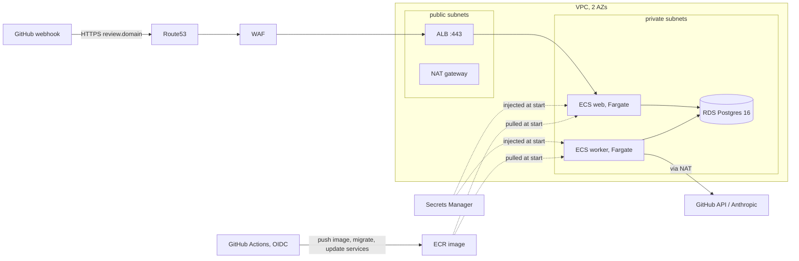

# Infrastructure (AWS, Terraform)

Decision record: [ADR 0011](../docs/decisions/0011-deploy-on-aws.md). The application is unchanged; this folder only
hosts it.



## Layout

| Path | What | Lifetime |
|---|---|---|
| `foundation/` | state bucket, ECR, secret containers, Route53 zone, ACM certificate, alerts topic, GitHub OIDC deploy role | persistent (pennies a month) |
| `app/` | VPC, NAT, RDS, ECS cluster and services, ALB, WAF, alarms, dashboard | **destroyed between demos** |
| `scripts/put-secrets.ps1` | copies 3 secrets from your local `.env` into Secrets Manager | run once (and on rotation) |
| `scripts/deploy.sh` | register task definitions, run the migration, roll web and worker, check for rollback | used by the pipeline, runnable by hand |
| `.checkov.yaml` | security-scan config; every skipped check has its reason | |

Values that identify your account (`terraform.tfvars`, `backend.hcl`) are gitignored. Copy the `*.example` files.

## First-time setup

Use the admin profile: `aws sso login --profile AdministratorAccess-<account-id>`, then
`$env:AWS_PROFILE = "AdministratorAccess-<account-id>"` in PowerShell.

**1. Foundation** (`cd infra/foundation`)
```powershell
copy terraform.tfvars.example terraform.tfvars   # fill in your repo and domain
terraform init
terraform apply                                   # first run uses LOCAL state: the state bucket does not exist yet
```
Then move the state into the bucket it created: uncomment the `backend "s3"` block in `versions.tf`, create
`backend.hcl` containing `bucket = "pr-review-tfstate-<account-id>"`, and run
`terraform init -backend-config=backend.hcl -migrate-state` (answer yes). Delete the local `terraform.tfstate*` files.

**2. Secrets** (from the repo root)
```powershell
./infra/scripts/put-secrets.ps1 -Profile AdministratorAccess-<account-id>
```

**3. First image** (ECR tags are immutable, so use a new tag every push)
```powershell
$acct = aws sts get-caller-identity --query Account --output text
aws ecr get-login-password --region us-east-1 | docker login --username AWS --password-stdin "$acct.dkr.ecr.us-east-1.amazonaws.com"
docker build -t "$acct.dkr.ecr.us-east-1.amazonaws.com/pr-review-agent:bootstrap-1" .
docker push "$acct.dkr.ecr.us-east-1.amazonaws.com/pr-review-agent:bootstrap-1"
```

**4. App stack** (`cd infra/app`)
```powershell
copy terraform.tfvars.example terraform.tfvars   # state_bucket, image_tag = bootstrap-1, github_app_id
copy ..\foundation\backend.hcl backend.hcl
terraform init -backend-config=backend.hcl
terraform plan
terraform apply
```
**5. Migrate and check** (needs `bash`, `jq`: `winget install jqlang.jq`)
```bash
AWS_REGION=us-east-1 bash infra/scripts/deploy.sh bootstrap-1
curl http://<alb_dns_name from terraform output>/health        # {"status":"ok"}
```
Until HTTPS exists, test with signed requests only. Do not point the real GitHub App at the HTTP address.

## When the domain transfer is done (Route53 is the registrar)
1. `terraform output name_servers` in `foundation`; set them as the domain's nameservers
   (Route53 > Registered domains > the domain > Name servers), or
   `aws route53domains update-domain-nameservers --region us-east-1 --domain-name <domain> --nameservers Name=<ns1> Name=<ns2> ...`.
   Check that the transfer did not also create a second hosted zone for the same name.
2. Set `enable_certificate = true` in `foundation/terraform.tfvars`, `terraform apply` (waits for DNS validation).
3. Set `enable_https = true` in `app/terraform.tfvars`, `terraform apply`.
4. Set the GitHub App's webhook URL to the `webhook_url` output. Open a sandbox PR, click **Redeliver** once.
5. GitHub repo > Settings > Environments > `production` > add yourself as required reviewer; Variables > add
   `AWS_DEPLOY_ROLE_ARN` (the `github_deploy_role_arn` output).

## Day to day
- **Deploy:** merge to `main`; CI passes; the Deploy workflow waits for your approval, then pushes a tag
  (first 12 characters of the commit), migrates, rolls the services. By hand: `bash infra/scripts/deploy.sh <tag>`.
- **Roll back:** `bash infra/scripts/deploy.sh <older-tag>` (tags are immutable, so an old tag is the old build).
  A failing new revision also rolls back by itself (circuit breaker).
- **Tear down:** `cd infra/app && terraform destroy`. A final RDS snapshot `pr-review-final-...` is kept; delete it in
  the console when it is no longer wanted (a few cents a month). `foundation` stays.
- **Rotate a secret:** change it at its source (GitHub App settings / Anthropic console), rerun
  `put-secrets.ps1`, then force a new deployment of both services:
  `aws ecs update-service --cluster pr-review --service pr-review-web --force-new-deployment` (and `-worker`).
- **Alerts:** `aws sns subscribe --topic-arn <alerts_topic_arn> --protocol email --notification-endpoint <you>` and
  confirm the email. Alarms: ALB 5xx, unhealthy web task, web/worker task count, RDS CPU/storage/connections, error logs.

## Security notes
- Tasks and database are in private subnets; the database accepts connections only from the web, worker and migration
  tasks; TLS is required (`rds.force_ssl`) and the app asks for it (`sslmode=require`).
- The execution role can read exactly the four secrets; the task role has no permissions (the app calls no AWS API).
- The deploy role can only push to one repository, register task definitions, run the migration task and update the two
  services. It cannot touch IAM, secrets or Terraform state. Only the `production` environment of this repo can assume it.
- WAF: rate limit and two managed rule groups block; the common rule set only COUNTS (webhook bodies are code and PR text,
  and a blocked genuine webhook is a lost review). The HMAC check in `app/main.py` is the real gate.
- Public repos: `PRIVATE_CHANNEL` stays `none` here (ADR 0008) until step 10.21 is done by hand.

## Known gaps (accepted, see `.checkov.yaml`)
Single NAT gateway and single-AZ database; no VPC flow logs, ALB or WAF logs; AWS-managed rather than customer-managed
KMS keys; 30-day log retention; Terraform plan/apply run by hand, not in CI (a CI apply role would be near-admin);
the generated database password lives in Terraform state (private, encrypted, versioned bucket).

## Cost
Not measured yet. Record real numbers here after the first full day up (Cost Explorer, filter by tag `Project=pr-review`).
